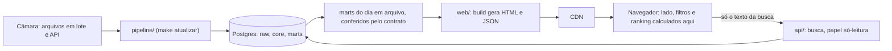

# Mapa do sistema

_Diagrama em Mermaid dos componentes e do fluxo de dados, da Câmara até a tela. Atualizado em todo PR que muda a arquitetura._

Estado: [ADR 0002](../decisoes/0002-forma-de-entrega-do-site.md) (entrega). Hospedagem, banco e modelo de busca ainda sem ADR.

Na hora do acesso, só a seta da busca chega a um servidor. O resto é arquivo pronto na CDN.
