# Mapa do sistema

_Diagrama em Mermaid dos componentes e do fluxo de dados, da Câmara até a tela. Atualizado em todo PR que muda a arquitetura._

Estado: [ADR 0002](../decisoes/0002-forma-de-entrega-do-site.md) (entrega), [ADR 0003](../decisoes/0003-framework-do-site.md) (Astro com ilhas em React), [ADR 0004](../decisoes/0004-banco-de-dados.md) (Postgres em Docker no Hetzner) e [ADR 0005](../decisoes/0005-hospedagem.md) (Nginx no Hetzner atrás do Cloudflare). Modelo de busca ainda sem ADR.

```mermaid
flowchart LR
  camara[Câmara: arquivos em lote e API] --> pipeline["pipeline/ (make atualizar)"]
  pipeline --> pg[(Postgres: raw, core, marts)]
  pg --> export[marts do dia em arquivo, conferidos pelo contrato]
  export --> build["web/: build do Astro gera HTML e JSON"]
  build -- rsync e troca de link --> nginx["Nginx no Hetzner: site e /api/"]
  nginx --> cdn[Cloudflare: DNS, HTTPS e cache]
  cdn --> nav[Navegador: lado, filtros e ranking calculados aqui]
  nav -- só o texto da busca, via Cloudflare e Nginx --> api["api/: busca, papel só-leitura"]
  api --> pg
```

Na hora do acesso, só a busca chega ao banco. O resto é arquivo pronto: do cache do Cloudflare ou, se não estiver lá, do Nginx.
