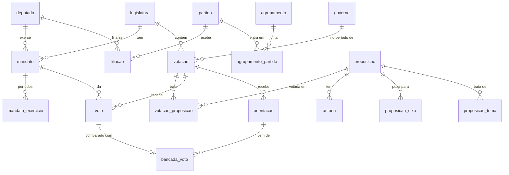

# Modelo de dados

_As quatro camadas (raw, core, ia, marts), as entidades de cada uma e como se relacionam._

Hoje cobre a pergunta 2. A regra de atualização de cada tabela está em [atualizacao.md](atualizacao.md); o detalhe coluna a coluna dos marts entra no [dicionário](dicionario.md) no marco `dados.contrato_marts`. Assume Postgres, como manda o [método](../metodo.md); se o ADR do banco (marco `infra.adrs`) escolher outro, as decisões 2 e 5 abaixo são revistas.

## Decisões (14/11/2026)

1. **A chave é o id da Câmara.** Deputado, proposição, votação, partido e legislatura usam o id que a Câmara publica, o mesmo que está na URL oficial (H6.3). A fonte é uma só, e um id próprio só serviria para juntar fontes. Onde a Câmara não dá id (bloco reconstruído, autor que não é deputado, orientação), a chave é composta pelos campos que a identificam.
2. **Validade no tempo é intervalo de datas com trava contra sobreposição.** Filiação, exercício do mandato e composição de federação e bloco guardam um `periodo` do tipo `daterange`, com uma restrição de exclusão (`EXCLUDE USING gist`, extensão `btree_gist`, que vem com o Postgres) que impede dois períodos sobrepostos para a mesma chave. Um deputado em dois partidos no mesmo dia é recusado pelo banco, em vez de aparecer no número publicado.
3. **A bancada de cada voto é uma tabela própria, com a origem de cada linha.** É inferência (partido, senão federação, senão bloco; o bloco às vezes reconstruído por eliminação), e o número de divergência depende dela. Numa tabela própria ela tem teste, aparece no "como calculamos" e serve à pergunta 3 sem refazer a conta.
4. **O perfil é deputado × legislatura.** A página, o endereço e todo agregado partem do `mandato` (deputado, legislatura), nunca do deputado sozinho. Quem exerceu em duas legislaturas tem dois mandatos, e nada no modelo junta os dois.
5. **Nenhuma chave natural tem coluna que pode ser nula.** No Postgres, `NULL` nunca é igual a `NULL`, então uma chave única com coluna nula não impede duplicata. Na v1, `tema_prop` chegou a 1.051.786 linhas para 112.597 pares distintos (9,3 vezes) por isso. Onde a fonte não dá um campo, a chave usa outro que ela sempre dá.
6. **O site só lê os marts.** O papel `app` tem `SELECT` só no schema `marts`; `core` e `ia` são do pipeline. O site não consegue montar por conta própria um número que não passou pelos testes de dados.

## As camadas

| Camada | Onde mora | Guarda | Quem escreve |
| --- | --- | --- | --- |
| `raw` | Fora do Postgres: CSV original comprimido com gzip (arquivos em lote) e JSON (API), um diretório por data lógica | Cópia exata do que veio, com URL, data de coleta e hash | Pipeline, só acrescenta |
| `core` | Schema `core` | Entidades limpas com as chaves da Câmara e as tabelas derivadas por regra | Pipeline, upsert idempotente |
| `ia` | Schema `ia` | O que vem de modelo: temas e direção por eixo, com versão | Pipeline, só o que falta |
| `marts` | Schemas `marts` (publicado) e `marts_rascunho` | Tabelas prontas para as telas | Pipeline monta no rascunho; a publicação troca os dois schemas de nome numa transação |
| controle | Schema `controle` | Até que data lógica cada passo processou e o registro de cada execução | Pipeline |

Toda linha de `core` tem `hash_origem` (da linha que a gerou), `atualizada_em` e, nas entidades, `removida_em` (nada é apagado).

## core

### Pessoas, mandatos e partidos

| Tabela | Chave | O que é |
| --- | --- | --- |
| `legislatura` | `id` | Número da legislatura e `periodo` (57ª: 01/02/2023 a 31/01/2027) |
| `governo` | `id` | Presidente da República e `periodo`, com trava contra sobreposição. Poucas linhas, mantidas no git (`dados/referencia/governos.csv`), porque a Câmara não publica. É o que separa a métrica por governo dentro de uma legislatura |
| `deputado` | `id` | A pessoa: nome civil, nome parlamentar, nascimento. Sem partido e sem UF, que mudam |
| `mandato` | `deputado_id`, `legislatura_id` | O perfil. Condição na legislatura (titular, suplente, efetivado) e UF |
| `mandato_exercicio` | `deputado_id`, `legislatura_id`, `periodo` | Cada período em exercício, sem sobreposição por mandato. Base da ausência quando substituir a janela de 15 dias |
| `partido` | `id` | Sigla e nome. Sigla muda (PSL e DEM viraram União): o id é o que vale |
| `filiacao` | `deputado_id`, `periodo` | Partido do deputado em cada período, sem sobreposição. Vem do histórico do deputado |
| `agrupamento` | `id` | Federação ou bloco parlamentar: `tipo`, `legislatura_id`, nome, `sigla_orientacao` (como aparece nas orientações, ex. `Bl UniPpPsd...`) e `id_camara` quando a Câmara publica |
| `agrupamento_partido` | `agrupamento_id`, `partido_id`, `periodo` | Quem estava em cada federação ou bloco e quando, com `origem`: `api`, `foto_diaria` ou `eliminacao`. Um partido não está em dois blocos ao mesmo tempo (trava contra sobreposição por partido e tipo) |

### Proposições

| Tabela | Chave | O que é |
| --- | --- | --- |
| `proposicao` | `id` | Sigla, número, ano, ementa, situação atual, `principal_id` (apensada aponta para a principal) |
| `proposicao_tema_camara` | `proposicao_id`, `cod_tema` | Tema oficial da Câmara. Não é a nossa taxonomia; serve de sinal e de conferência |
| `autoria` | `proposicao_id`, `ordem_assinatura` | Autor, `uri_autor` e `deputado_id` (vazios quando não há: em 2025, 2.131 linhas de senador vêm sem URI), tipo e se é proponente. Autor principal: ordem 1 e proponente. O mesmo deputado pode aparecer em duas ordens da mesma proposição (682 casos em 2025), então a contagem de autoria conta a proposição uma vez por deputado |

### Votações

| Tabela | Chave | O que é |
| --- | --- | --- |
| `votacao` | `id` (texto, ex. `2458405-38`) | Data, órgão, descrição, resultado, `legislatura_id` e `governo_id` (derivados da data) |
| `votacao_proposicao` | `votacao_id`, `proposicao_id`, `relacao` | Que proposição a votação afeta ou tem como objeto |
| `voto` | `votacao_id`, `deputado_id` | Sim, Não, Abstenção, Obstrução, Artigo 17 (o presidente da sessão, que não vota) ou vazio (887 votos de 2023 a 2026 vêm sem valor: guardados como `sem_valor`, nunca descartados, e o teste de dados conta quantos são). Guarda a sigla de partido publicada no voto e o `legislatura_id`, que liga o voto ao `mandato`: voto sem mandato é recusado |
| `orientacao` | `votacao_id`, `sigla_bancada` | Orientação como veio e o tipo da bancada: governo, oposição, maioria, minoria, partido, federação ou bloco, ligada ao `partido` ou ao `agrupamento` |

### Derivadas por regra

| Tabela | Chave | O que é |
| --- | --- | --- |
| `votacao_classificada` | `votacao_id` | O tipo da votação e a proposição cujo texto foi votado, cada um com a `origem` da resposta. Tipo: mérito, regime de tramitação (urgência), requerimento, redação final, destaque ou emenda de Plenário, emenda do Senado, outro; sai da descrição por regra com teste. Proposição votada: o objeto, quando é um só; senão a afetada com o número citado na descrição; senão a primeira de um tipo com texto (PL, PEC, PLP, MPV, PDL), a regra que a v1 usava em `12_coletar_votacoes_plenario.py`. Em 2025, das 2.041 votações de Plenário, só 918 têm um objeto só, e 454 são de regime de tramitação. É o que decide quais votações entram na pergunta 2 (H2.6) e de qual proposição sai a direção do voto |
| `bancada_voto` | `votacao_id`, `deputado_id` | A bancada do deputado naquela votação (partido, federação ou bloco), a orientação dela e a `origem` da resposta (`orientacao_propria`, `federacao`, `bloco_api`, `bloco_foto`, `bloco_eliminacao`). Vazia para deputado sem partido e para votação sem orientação. É a base da divergência ([metricas.md](../produto/metricas.md#divergência-da-bancada)) |

Derivada fica em `core`, e não em `marts`, porque é fato reconstruído e não número de tela: recalcula inteira a cada execução, a partir de `orientacao`, `filiacao` e `agrupamento_partido`.

## ia

Cada linha guarda `versao_taxonomia`, `modelo`, `versao_prompt` e `hash_entrada`. A regra de classificação e de versão é de [taxonomia.md](taxonomia.md) (marco `taxonomia.incremental`).

| Tabela | Chave | O que é |
| --- | --- | --- |
| `tema` e `eixo` | `id`, `versao_taxonomia` | Carregados de `taxonomia/temas.yaml` e `taxonomia/eixos.yaml`. Ids estáveis, nunca renumerados |
| `proposicao_tema` | `proposicao_id`, `tema_id`, `versao_taxonomia` | Temas da proposição na versão, com confiança |
| `proposicao_eixo` | `proposicao_id`, `eixo_id`, `versao_taxonomia` | Sinal da proposição no eixo: `+`, `−` ou misto |

## marts

Recálculo total a cada execução, num schema de rascunho, publicado de uma vez depois dos testes de dados. O schema de cada mart é o contrato com o site: está em [`db/marts/contrato.yaml`](../../db/marts/contrato.yaml) e explicado no [dicionário](dicionario.md).

## Como se ligam

## O que muda em relação à v1

Comparado com `scripts/schema.sql` e `scripts/legislativo/` do repositório `capivara`, em 14/11/2026.

| Na v1 | Problema | Na v2 |
| --- | --- | --- |
| `deputado.partido_id`, `in_leg_56`, `in_leg_57`, `condicao_leg_56`, `condicao_leg_57` | Partido atual no lugar do da época; uma coluna nova a cada legislatura | `filiacao` com período; `mandato` por legislatura |
| `orientacao_votacao` com `partido_id NOT NULL`, preenchida pelo mapa sigla → partido | Orientação de bloco, federação, Governo e Oposição era descartada sem aviso (`if pid is None: continue`) | `orientacao` guarda toda bancada, com o tipo |
| `partidos.id` serial, chave pela sigla | Sigla muda (PSL e DEM viraram União) | Id do partido da Câmara |
| `voto` sem partido | O partido da época tinha de ser adivinhado | Sigla publicada no voto, mais `filiacao` para conferir |
| `votacao.proposicao_id`, uma só, escolhida na coleta | A regra ficava escondida no script de coleta | `votacao_proposicao` guarda todas; `votacao_classificada` escolhe por regra com origem e teste |
| `tema_prop` com chave única sobre coluna nula | 9,3 vezes de duplicação, achada em 14/09/2026 | Regra 5: chave natural sem coluna nula |
| `ON CONFLICT DO NOTHING` | Linha que mudou na fonte nunca era atualizada | Upsert por hash de linha |
| Estado "já processadas" por id | Votação reprocessada só com `--limpar` | Checkpoint por data lógica |
| `proposicao.partido_autor` | Partido do autor congelado na proposição | Sai de `autoria` e `filiacao` na data |

Ficam como na v1: id texto da votação (`2458405-38`), uma linha por proposição real com a apensada apontando para a principal, chave do discurso por deputado e data e hora (quando entrar), federação com período.

Ficam para depois, sem retrabalho: `orgao` (a pergunta 2 só usa o Plenário, e a chave estrangeira entra quando a pergunta 1 chegar), `tramitacao` (marco `dados.tramitacao`), `discurso`.

## Papéis no banco

| Papel | Pode |
| --- | --- |
| `pipeline` | Escrever em `core`, `ia`, `marts_rascunho` e `controle`; trocar `marts_rascunho` por `marts` |
| `app` | Ler `marts`. Nada mais |
| `migrador` | Mudar schema, só pelas migrations revisadas com `/migracao` |
